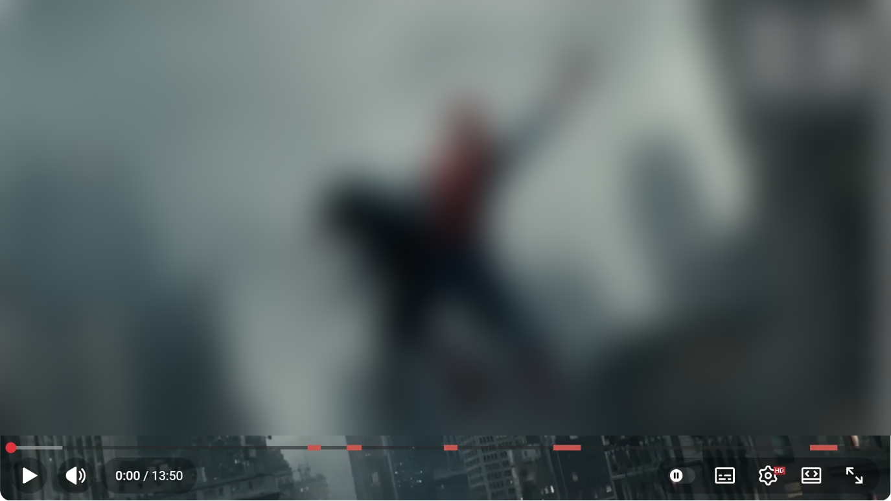
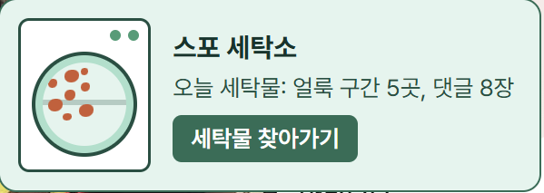
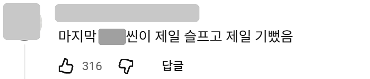
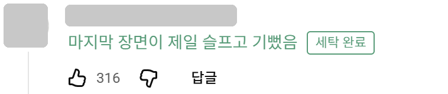
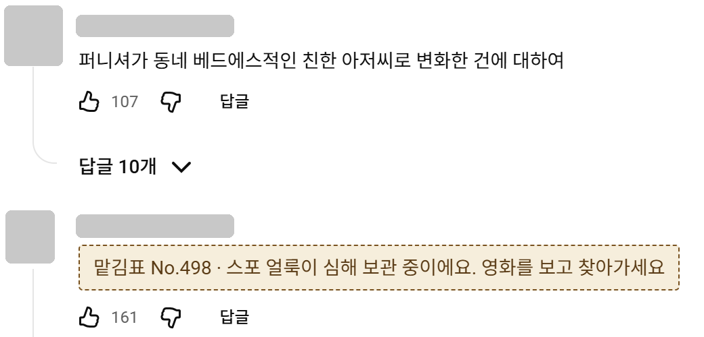
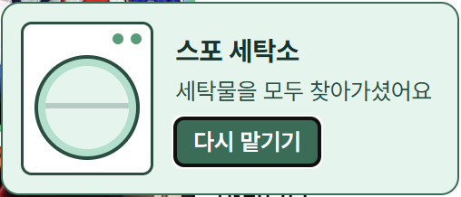

# 스포 세탁소 프로토타입

유튜브 영화 리뷰에서 감정과 평가는 남기고 스포일러만 지우는 크롬 확장과 로컬 서버입니다.
`sample_movie`는 동작 확인용 가상 영화이며, 이 데이터의 결과는 레포트 성능 근거로 쓰지 않습니다.

> **스포일러 주의:** `server/data/movies/brand_new_day.json`과 `server/data/samples/brand_new_day_smoke.csv`에는 영화 "스파이더맨: 브랜드 뉴 데이"의 전개와 결말이 들어 있습니다.

아직 프로토타입이며 스포 판단 정확도는 낮습니다. 스포를 놓치거나 평가를 스포로 잘못 가릴 수 있습니다.

## 실행 화면

리뷰 영상을 열면 진행 바에 스포 구간이 빨갛게 표시되고 자동으로 건너뜁니다. 오른쪽 아래 패널에 세탁한 구간과 댓글 수가 나옵니다.

 

스포 부분만 덜어 낼 수 있는 댓글은 그 부분을 지운 문장으로 바꾸고 "세탁 완료"를 붙입니다.

| 세탁 전 (인물 이름은 가림) | 세탁 후 |
|---|---|
|  |  |

스포가 심한 댓글은 맡김표로 바꿉니다. 영화를 본 뒤 "세탁물 찾아가기"를 누르면 원래 댓글과 구간이 돌아옵니다.

 

캡처 출처: YouTube "김채호의 필름찢기" 채널의 [스파이더맨: 브랜드 뉴 데이 리뷰](https://www.youtube.com/watch?v=y7KN61E-4Qo) 영상 화면과 댓글, 2026년 11월 캡처. 확장 프로그램의 동작을 설명하기 위해서만 썼습니다. 영상 화면은 흐리게 처리했고, 댓글 작성자의 닉네임과 프로필 사진은 가렸습니다.

## 준비

- Python 3.12에서 확인했습니다.
- `server/requirements.txt`의 패키지를 설치합니다.
- [Ollama](https://ollama.com)를 설치하고 `ollama pull exaone3.5:2.4b`로 모델을 받습니다. Ollama가 없으면 LLM 확인과 댓글 세탁 없이 동작합니다.

## 실행

```bash
cd server
.venv/Scripts/python -m uvicorn app:app --host 127.0.0.1 --port 8765
```

1. `chrome://extensions`에서 개발자 모드를 켭니다.
2. "압축해제된 확장 프로그램을 로드합니다"로 `extension` 폴더를 선택합니다.
3. 등록한 영상을 유튜브에서 엽니다.

## 데모 영화 등록

1. `server/data/movies/<영화ID>.json`에 등장인물과 사실 목록을 작성합니다. 사실의 `risk`는 `safe`, `medium`, `high` 중 하나입니다.
2. 리뷰 영상을 분석합니다.

```bash
.venv/Scripts/python ingest.py --video-id <유튜브 영상 ID> --movie <영화ID> --audio <음성 파일>
```

## 기준값 측정

확장이 판단한 댓글은 `server/data/comments/`에 내용만 모입니다. 이를 정답 표시용 CSV로 나눕니다. `tune`은 모델 판단이 채워져 있고, `test`는 비어 있습니다.

```bash
.venv/Scripts/python export_labels.py --movie <영화ID>
```

`tune`으로 기준값을 고른 뒤, `test`에는 그 값 하나만 적용합니다.

```bash
.venv/Scripts/python evaluate.py --movie <영화ID> --labels data/labels/<영화ID>_tune.csv --llm
```

```bash
.venv/Scripts/python evaluate.py --movie <영화ID> --labels data/labels/<영화ID>_test.csv --llm --threshold <기준값>
```

댓글 기준값은 측정으로 정했지만, 영상 구간 기준값(`SEGMENT_SIM_THRESHOLD`)은 정답 데이터로 측정하지 않았습니다.

## 라이선스

직접 작성한 코드는 [MIT 라이선스](LICENSE)를 따릅니다. 다음은 MIT 적용 대상이 아닙니다.

- `server/data/movies/brand_new_day.json`: 한국어 위키백과 [스파이더맨: 브랜드 뉴 데이](https://ko.wikipedia.org/wiki/스파이더맨:_브랜드_뉴_데이)의 줄거리를 요약해 고쳐 쓴 자료로, [CC BY-SA 4.0](https://creativecommons.org/licenses/by-sa/4.0/deed.ko)을 따릅니다.
- LLM 모델 `exaone3.5:2.4b`: 저장소에 포함되어 있지 않습니다. 사용 전에 [모델 페이지](https://ollama.com/library/exaone3.5)의 라이선스를 확인하세요. 비상업적 사용 조건이 있을 수 있습니다.
- 사용하는 Python 패키지와 임베딩 모델: 각자의 라이선스를 따릅니다.
- `docs/screenshots/`: 영상 화면과 댓글의 저작권은 각 저작자에게 있습니다. 위 출처를 밝히고 설명용으로만 인용했습니다.

SponsorBlock은 구간 건너뛰기 구조만 참고했으며 코드는 포함하지 않았습니다.
